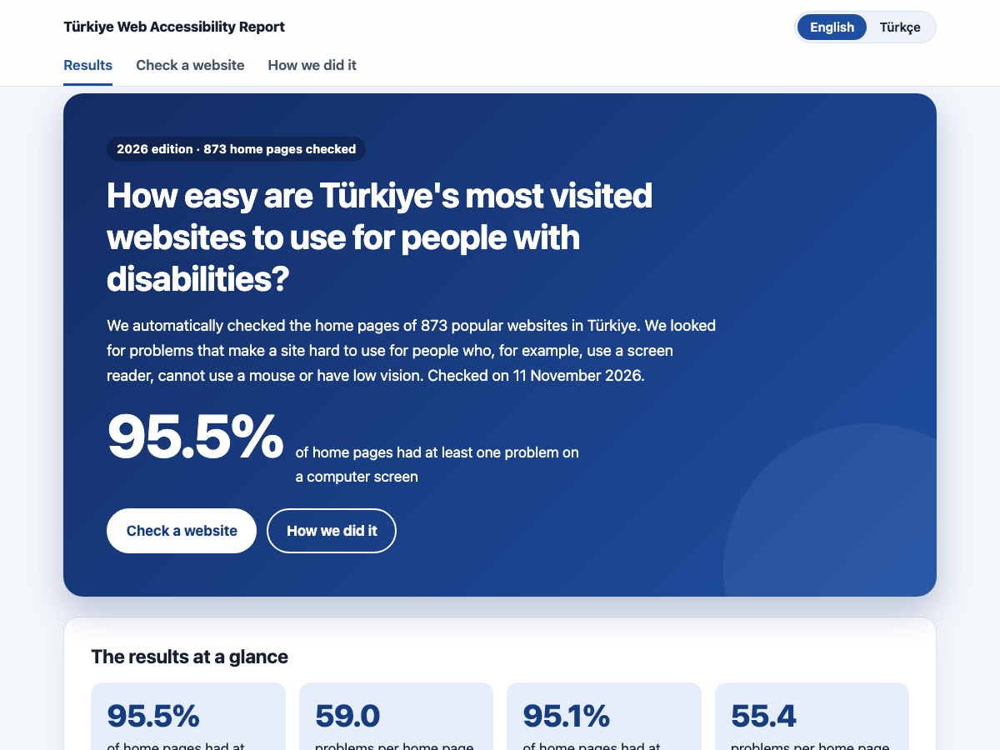
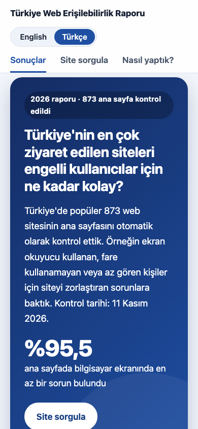
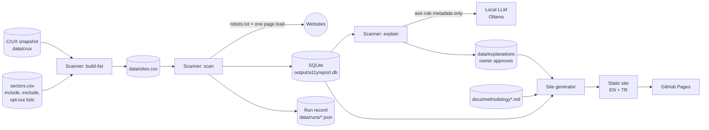

# Türkiye Web Accessibility Report

Once a year, this project checks the home pages of the 1,000 most visited websites in Türkiye
for accessibility problems that software can detect (WCAG 2.2 Level A and AA), and publishes the
results by sector, in English and Turkish.

- **Report:** https://yunuskngl.github.io/turkiye-web-accessibility-report/ ·
  [Türkçe](https://yunuskngl.github.io/turkiye-web-accessibility-report/tr/)
- **Check one website:** https://yunuskngl.github.io/turkiye-web-accessibility-report/lookup.html
- **Methodology:** [docs/methodology.md](docs/methodology.md) ·
  [Türkçe](docs/methodology.tr.md)





## 2026 results in short

| | Computer screen | Phone screen |
|---|---|---|
| Home pages with at least one problem | 95.5% | 95.1% |
| Average problems per home page (median on a computer screen: 29) | 59.0 | 55.4 |

873 of 995 home pages could be checked on 11 November 2026 (the list had 1,000 sites; 5 whose
domain is a person's name were removed afterwards). The most common problems were low contrast
text (75.7% of pages), links without a text name (64.6%), images without alternative text (45.5%)
and touch targets that are too small (45.0%).

This is an automated check, **not** a legal audit: software finds only some barriers, so "no
problems found" does not mean a site is easy for everyone to use. The report shows sectors only;
it does not rank or name websites.

## Features

- **Scanner** (console app): builds the site list from Chrome UX Report data, checks robots.txt,
  loads each home page once in Chromium (Playwright), runs axe-core on a computer and a phone
  screen size, and stores technical results in SQLite. Runs are resumable and every run writes an
  audit record with tool versions, settings and request counts.
- **Static report site** (English and Turkish): headline numbers, sector comparison, most common
  problems, page structure, coverage and methodology. Charts are inline SVG, each followed by a
  table with the same numbers. Our own scanner finds zero problems on every page of the site.
- **Site lookup:** anyone can type a website address to see that site's result. There is no list
  of sites on the site; each result is stored under the SHA-256 hash of its domain.
- **Turkish explanations** for every failed rule, drafted with AI from axe-core's rule definitions
  only (never from website content) and approved by the project owner before publishing.
- **Opt-out:** website owners can ask to be left out through a GitHub issue form.

## Responsible scanning

- One page load per site per run, at most 3 sites in parallel, one new site every 3 seconds.
- robots.txt is respected; sites that refuse the request (403, 429, 503) are not retried.
- An honest User-Agent: `TurkiyeWebA11yReport/1.0` with a link to the methodology page.
- Only technical results are stored (rule ids, counts, short HTML snippets); no page text,
  cookies, screenshots of scanned sites or personal data. Snippets are not published.

## Architecture



| Project | Responsibility |
|---|---|
| `src/A11yReport.Core` | Models, site list rules, sectors, robots.txt rules, aggregation, explanation drafting |
| `src/A11yReport.Storage` | EF Core + SQLite: entities, migrations, run store, report reader |
| `src/A11yReport.Scanner` | Console app: `build-list`, `url`, `scan`, `explain`, `install-browser` |
| `src/A11yReport.Site` | Static site generator (HTML, CSS, vanilla JS, SVG charts, JSON) |
| `tests/A11yReport.Tests` | xUnit unit and integration tests; integration tests use local fixture pages only |

## Getting started

Requirements: [.NET 10 SDK](https://dotnet.microsoft.com/download). Run all commands from the
repository root.

```bash
dotnet build
dotnet run --project src/A11yReport.Scanner -- install-browser
dotnet test
```

Check one website (robots.txt is checked first):

```bash
dotnet run --project src/A11yReport.Scanner -- url example.com.tr
```

Build the site list, run a scan and generate the site:

```bash
dotnet run --project src/A11yReport.Scanner -- build-list data/crux/tr-202610.csv.gz
dotnet run --project src/A11yReport.Scanner -- scan --run 2026-full
dotnet run --project src/A11yReport.Site -- --run 2026-full
```

The site is written to `site/`. A scan of 1,000 sites takes about 1.5 hours and can be stopped
with Ctrl+C and resumed with the same command. Settings live in
`src/A11yReport.Scanner/appsettings.json` and `src/A11yReport.Site/appsettings.json`.

Turkish explanations of new rules are drafted with a local model (needs [Ollama](https://ollama.com)
and the `gemma3:4b` model) and must be approved in `data/explanations/rules.tr.json`:

```bash
dotnet run --project src/A11yReport.Scanner -- explain --run 2026-full
```

## Continuous integration

- **CI** (`.github/workflows/ci.yml`): on every push to `main` and every pull request, builds with
  warnings as errors and runs all tests (including the browser-based integration tests on local
  fixture pages).
- **Yearly scan** (`.github/workflows/scan.yml`): manual only (`workflow_dispatch`), never
  scheduled. It uploads the database and run record as an artifact; it does not commit or
  publish anything. The 2026 run was made from a computer in Türkiye; a run on GitHub's servers
  would come from outside Türkiye, which some sites treat differently.

## Data and licenses

- Site list: Chrome UX Report (CrUX) by Google, CC BY-SA 4.0, via
  [zakird/crux-top-lists](https://github.com/zakird/crux-top-lists).
- axe-core by Deque Systems, MPL-2.0, used unmodified.
- See [THIRD-PARTY-NOTICES.md](THIRD-PARTY-NOTICES.md) for all third-party components.
- This project's own code is licensed under the [MIT License](LICENSE). Data and third-party
  components keep their own licenses (above).
